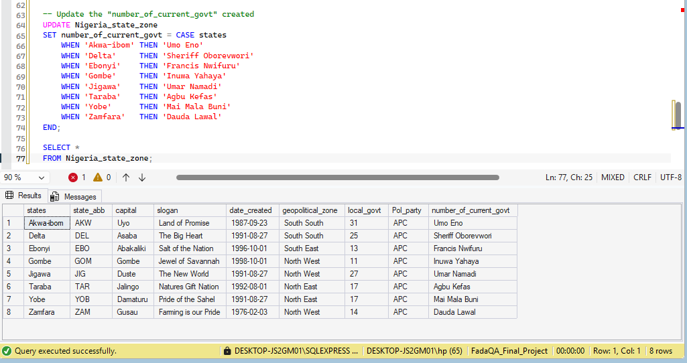

# Nigeria States Reference Table: SQL Schema Design & Data Manipulation

A foundational relational database project executed in **Microsoft SQL Server (SSMS)** demonstrating Data Definition Language (DDL) and Data Manipulation Language (DML) workflows. Using a reference table of eight Nigerian states (`Nigeria_state_zone`), this project covers schema creation with primary key constraints, batch record insertion, targeted record updates, schema evolution (`ALTER TABLE`), and conditional bulk updates using `CASE` expressions[cite: 1, 2, 5].

---

## Project Preview

The output below shows the final verified state of the `Nigeria_state_zone` table in SQL Server Management Studio (SSMS) following schema alteration and conditional `CASE` updates across all eight records[cite: 5]:



**What to notice in this output:**
* All 8 state records are structured under a primary key (`states`) alongside standardized attributes (`state_abb`, `capital`, `slogan`, `date_created`, `geopolitical_zone`, `local_govt`, `Pol_party`)[cite: 2, 5].
* Initial placeholder slogans were corrected via targeted `UPDATE ... WHERE` statements, and the newly added column (`number_of_current_govt`) was populated in a single transaction using a `CASE` statement[cite: 1, 3, 5].

---

## Project Context & Objectives

In operational analytics and reporting, raw reference tables frequently require structural updates, standardized attributes, and bulk corrections before they can reliably support downstream queries or dashboards. 

Completed as a practical SQL capstone exercise (`FadaQa_Final_Project`), this project was designed to practice and verify core relational database operations in T-SQL[cite: 5]:

1. **Enforce Entity Integrity:** Define an explicit table schema with appropriate data types and a `PRIMARY KEY` constraint to prevent duplicate state entries[cite: 2].
2. **Standardize Reference Records:** Correct inaccurate initial text values (state slogans and spelling) without disrupting existing key relationships[cite: 1, 3, 5].
3. **Evolve an Existing Schema:** Extend a populated table with a new attribute column (`ALTER TABLE`) without data loss[cite: 1].
4. **Execute Conditional Bulk Updates:** Populate new attributes across multiple rows cleanly using a single `UPDATE ... CASE WHEN` block rather than repetitive single-row statements[cite: 1, 5].

---

## Dataset Description & Scope

* **Database & Table:** `FadaQa_Final_Project.dbo.Nigeria_state_zone`[cite: 2, 5]
* **Classification:** Training / simulated reference dataset created manually via SQL `INSERT` statements[cite: 2].
* **Dimensions:** 8 rows (states) × 9 columns (expanded from 8 initial columns)[cite: 2, 5].

### Schema Overview

| Column Name | Data Type | Constraint / Role | Description |
| :--- | :--- | :--- | :--- |
| `states` | `VARCHAR(50)` | `PRIMARY KEY` | Name of the Nigerian state (unique identifier) |
| `state_abb` | `VARCHAR(7)` | Standard attribute | Three-letter state abbreviation (e.g., `AKW`, `DEL`, `JIG`) |
| `capital` | `VARCHAR(20)` | Standard attribute | State capital city |
| `slogan` | `VARCHAR(20)` | Standard attribute | Official or assigned state motto/slogan |
| `date_created` | `VARCHAR(20)` | Standard attribute | Date the state was created (`YYYY-MM-DD` format) |
| `geopolitical_zone` | `VARCHAR(50)` | Standard attribute | Administrative geopolitical region |
| `local_govt` | `INT` | Standard attribute | Count of Local Government Areas (LGAs) |
| `Pol_party` | `VARCHAR(10)` | Standard attribute | Political party label |
| `number_of_current_govt` | `VARCHAR(30)` | Added via `ALTER TABLE` | Stores the name of the sitting state governor |[cite: 1, 2, 5]

---

## Tools & Technologies

* **Microsoft SQL Server (`SQLEXPRESS`):** Relational database engine used to store and manage the table[cite: 5].
* **SQL Server Management Studio (SSMS):** Query execution, result grid verification, and script validation[cite: 3, 4, 5].
* **T-SQL (DDL & DML):** Used `CREATE TABLE`, `INSERT INTO`, `UPDATE`, `ALTER TABLE`, `CASE WHEN`, and `SELECT` statements[cite: 1, 2].

---

## Technical Workflow & Methodology

### 1. Table Creation & Initial Data Ingestion
Created the `Nigeria_state_zone` table with `states` assigned as the `PRIMARY KEY`, followed by a multi-row `INSERT INTO` statement populating eight initial state records (`Jigawa`, `Dalta`, `Yobe`, `Zamfara`, `Ebonyi`, `Gombe`, `Akwa-ibom`, and `Taraba`)[cite: 2].

```sql
CREATE TABLE Nigeria_state_zone (
    states VARCHAR(50) PRIMARY KEY,
    state_abb VARCHAR(7),
    capital VARCHAR(20),
    slogan VARCHAR(20),
    date_created VARCHAR(20),
    geopolitical_zone VARCHAR(50),
    local_govt INT,
    Pol_party VARCHAR(10)
);
```[cite: 2]


### 2. Targeted Record Updates & Data Cleaning
Audited the initial records and executed targeted `UPDATE ... WHERE` statements to replace placeholder slogans for five states (`Jigawa`, `Yobe`, `Akwa-ibom`, `Zamfara`, and `Gombe`), alongside correcting the spelling of `'Dalta'` to `'Delta'`[cite: 1, 3, 5].

```sql
UPDATE Nigeria_state_zone
SET slogan = 'The New World'
WHERE states = 'Jigawa';

UPDATE Nigeria_state_zone
SET slogan = 'Pride of the Sahel'
WHERE states = 'Yobe';
```[cite: 1, 3]


### 3. Schema Alteration & Conditional `CASE` Update
Extended the existing table structure using `ALTER TABLE ... ADD` to introduce a new `VARCHAR(30)` column, then populated all eight rows in a single pass using a `CASE` expression mapped against the `states` primary key[cite: 1, 5]:

```sql
ALTER TABLE Nigeria_state_zone
ADD number_of_current_govt VARCHAR(30);

UPDATE Nigeria_state_zone
SET number_of_current_govt = CASE states
    WHEN 'Akwa-ibom' THEN 'Umo Eno'
    WHEN 'Delta'     THEN 'Sheriff Oborevwori'
    WHEN 'Ebonyi'    THEN 'Francis Nwifuru'
    WHEN 'Gombe'     THEN 'Inuwa Yahaya'
    WHEN 'Jigawa'    THEN 'Umar Namadi'
    WHEN 'Taraba'    THEN 'Agbu Kefas'
    WHEN 'Yobe'      THEN 'Mai Mala Buni'
    WHEN 'Zamfara'   THEN 'Dauda Lawal'
END;
```[cite: 1, 5]

### 4. Output Verification
Executed `SELECT * FROM Nigeria_state_zone;` after every DDL and DML operation to verify row counts, confirm zero unintended `NULL` values in updated fields, and validate final table integrity[cite: 1, 2, 3, 4, 5].

---

## Key Technical Observations

* **Set-Based Efficiency vs. Row-by-Row Updates:** During the slogan correction phase, five separate `UPDATE` statements were executed sequentially[cite: 1, 3]. In the final phase, consolidating eight governor assignments into a single `UPDATE ... CASE` statement reduced transaction overhead and improved script readability[cite: 1, 5].
* **Primary Key Dependency in Updates:** Because `UPDATE ... WHERE` and `CASE` conditions match strictly on string values in `states`, normalizing `'Dalta'` to `'Delta'` was essential before running the conditional mapping so that the row did not evaluate to `NULL`[cite: 3, 5].
* **Data Structure Summary:** Across the eight sampled states, Local Government Area (`local_govt`) counts range from **11** (Gombe) to **31** (Akwa Ibom), with state creation dates spanning **1976-02-03** (Zamfara) to **1998-10-01** (Gombe)[cite: 5].

---

## Limitations & Data Notes

To maintain analytical transparency, reviewers should note the following characteristics of this training dataset:

1. **Simulated / Exercise Values:** Several attributes reflect exercise inputs rather than official civic records (for example, `Gombe` is recorded under `North West` instead of North East, `Dutse` is spelled `Duste`, and `Pol_party` is uniformly populated as `APC` across all eight states)[cite: 2, 5].
2. **Column Naming Convention:** The added column `number_of_current_govt` stores text strings representing the names of sitting governors rather than a numeric count[cite: 1, 5]. In a production schema, naming this column `current_governor` would better reflect its `VARCHAR` data type and content.
3. **Date Storage Type:** `date_created` was defined as `VARCHAR(20)` rather than `DATE`, which stores the ISO string format (`YYYY-MM-DD`) cleanly for display but would require type casting (`CAST` or `CONVERT`) for chronological date arithmetic[cite: 2].

---

## Repository Structure

```text
nigeria-states-sql-database-management/
├── README.md
├── sql/
│   └── nigeria_state_zone_ddl_dml.sql    # Full T-SQL script (CREATE, INSERT, UPDATE, ALTER, CASE) [proposed]
└── images/
    ├── FadaQa_Project_1.png              # Formatted script: CREATE TABLE & INSERT INTO
    ├── FadaQa_Project_2.png              # Formatted script: UPDATE, ALTER TABLE & CASE WHEN
    ├── fadaqa_table_created.png          # SSMS query and initial 8-row result grid
    ├── fadaqa_update_1.png               # SSMS slogan updates and intermediate result grid
    └── fadaqa_update_data.png            # SSMS final CASE update and complete 9-column output
```[cite: 1, 2, 3, 4, 5]

*(Note: Place your `.sql` script inside the `sql/` directory and your existing screenshot files inside `images/` so all embedded README previews render properly.)*

---

## How to Reproduce

1. Open **SQL Server Management Studio (SSMS)** and connect to a local SQL Server instance (e.g., `SQLEXPRESS`)[cite: 5].
2. Create and select a target database:
   ```sql
   CREATE DATABASE FadaQa_Final_Project;
   GO
   USE FadaQa_Final_Project;
   GO
   ```[cite: 5]
3. Run the DDL and DML blocks in order:
   * Execute `CREATE TABLE Nigeria_state_zone` and `INSERT INTO` to initialize the 8 state rows[cite: 2].
   * Execute the `UPDATE` statements to standardize the state slogans and state spelling[cite: 1, 3, 5].
   * Execute `ALTER TABLE` followed by the `UPDATE ... CASE` statement to add and populate the governor column[cite: 1, 5].
   * Run `SELECT * FROM Nigeria_state_zone;` to verify the final 8-row, 9-column table[cite: 5].

---

## Learning Outcomes & Future Improvements

* **Schema Design Precision:** Enforcing `PRIMARY KEY` constraints early prevents duplicate entity records during batch ingestion[cite: 2].
* **Future Enhancements:**
  * Expand the table to include all **36 Nigerian states and the Federal Capital Territory (FCT)** with verified geopolitical zones, LGA counts, and political party affiliations.
  * Convert `date_created` from `VARCHAR(20)` to a native `DATE` data type and rename `number_of_current_govt` to `current_governor` for clearer semantic alignment[cite: 1, 2, 5].
  * Add analytical aggregation queries (`GROUP BY geopolitical_zone`, `SUM(local_govt)`, `COUNT(*)`) to summarize regional LGA distribution.

---

## Author

**Abdullahi Muhammed Soliu**
Data & Business Intelligence Analyst
Email: [abdullahimuhammedsoliu0018@gmail.com]
[Linkedin](https://www.linkedin.com/in/abdullahi-muhammed-soliu-074598417)
